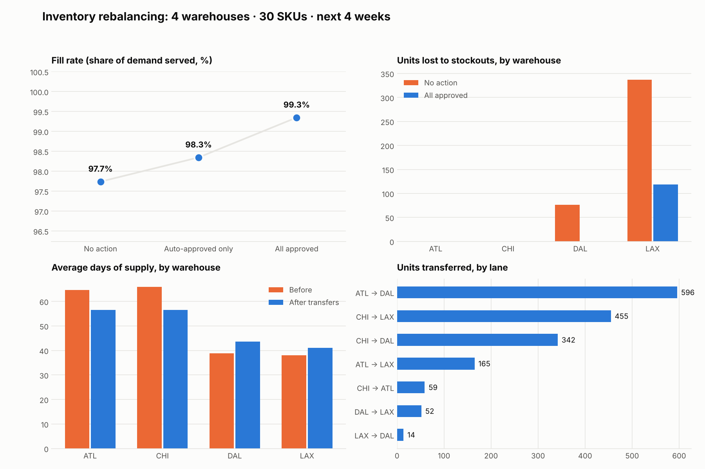
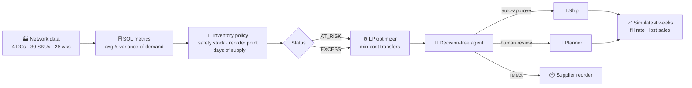

<div align="center">

# 📦 Inventory Rebalancing Agent

**Find stock in the wrong warehouse, move it where demand is going, and let an agent decide which moves ship automatically.**
SQL inventory metrics + a minimum-cost transfer optimizer + a decision-tree agent with human review, tested on a simulated 4-warehouse network.

<p>
  <a href="https://github.com/achux11/inventory-rebalancing-agent/actions/workflows/ci.yml"></a>
  
  
  
  
</p>

</div>

---

## 🤔 The problem

Demand shifted: **Dallas and Los Angeles are up ~30%**, while **Atlanta and Chicago are down ~20%**. Inventory is still positioned for the old demand mix, so the network has plenty of stock overall but it sits in the wrong places.

A supplier reorder takes **3–4 weeks**. A transfer between warehouses takes **1 week**. This project finds the cheapest set of transfers that fixes the imbalance and lets an agent decide which moves are safe to ship without a planner.

## 📊 Results (next 4 weeks of held-out demand)

| Scenario | Fill rate | Units lost | Lost sales (at cost) | Stockout weeks | Freight |
|---|---|---|---|---|---|
| No action | 97.7% | 413 | $55,711 | 12 | $0 |
| Agent auto-approved moves only | 98.3% | 302 | $41,349 | 6 | $1,409 |
| **All approved moves** | **99.3%** | **119** | **$16,403** | **2** | **$2,991** |

> 💡 **$39,307 of lost sales avoided for $2,991 of freight (13.1× return)**, with stockout weeks cut from 12 to 2.

<p align="center"></p>

## 🧠 How it works



1. **SQL metrics:** load the network into SQLite and compute recent average and variance of weekly demand per SKU and warehouse (`rebalancer/queries.sql`).
2. **Inventory policy:** safety stock = *z* × σ × √(lead time + review), reorder point = demand over the protection period + safety stock, and days of supply = on hand ÷ daily demand. Positions are tagged **AT_RISK** (below reorder point), **EXCESS** (more than 8 weeks of supply) or **HEALTHY**.
3. **Optimizer:** for each SKU, a transportation linear program moves surplus stock (above target) to at-risk warehouses at the lowest freight cost. Need that transfers can't cover falls to a supplier reorder. A source is never drained below its own target.
4. **Agent:** a decision tree reviews every proposed transfer and logs which rule fired and why.
5. **Simulation:** replays the next 4 weeks of held-out demand under each scenario to measure what actually changes.

## 🤖 The agent's decision tree

| Rule | Condition | Action |
|---|---|---|
| R1 | Freight is more than 25% of the goods' value | ❌ **Reject**: a supplier reorder is cheaper |
| R2 | Move is worth $15,000 or more | 👤 **Human review** |
| R3 | Destination has under 7 days of supply | ✅ **Auto-approve**: urgent |
| R4 | Lane is over 1,500 miles and not urgent | 👤 **Human review** |
| R5 | Everything else | ✅ **Auto-approve** |

On this run: **39 transfers proposed (1,683 units) → 27 auto-approved, 12 sent to human review, 0 rejected.**

## 🚀 Run it

```bash
git clone https://github.com/achux11/inventory-rebalancing-agent.git
cd inventory-rebalancing-agent
pip install -r requirements.txt
python run.py
```

**In Google Colab:** run the same commands in a cell with `!` in front of each.

Outputs land in `outputs/`:

| File | What's in it |
|---|---|
| `dashboard.png` | fill rate, stockouts by warehouse, days of supply before/after, units by lane |
| `rebalancing_report.xlsx` | summary with live formulas (lost sales avoided, return on freight), warehouse status, transfer decisions, network positions |
| `transfer_decisions.csv` | every proposed transfer with the agent's action, rule and reason |
| `network_positions.csv` | safety stock, reorder point, days of supply and status for all 120 positions |
| `results.json` | all metrics from the run |

## ✅ Tests

```bash
pip install pytest && pytest -q
```

12 tests check that the SQL statistics match pandas, that the policy is consistent, that transfers never drain a source below target and only go to at-risk positions, every branch of the agent's decision tree, and that rebalancing improves fill rate.

## 📁 Project structure

```
inventory-rebalancing-agent/
├── run.py                  # end-to-end pipeline
├── rebalancer/
│   ├── data.py             # 🏭 synthetic network: warehouses, SKUs, lanes, demand, inventory
│   ├── queries.sql         # 🗄️ SQL: demand stats, network position, warehouse rollup
│   ├── metrics.py          # 📐 safety stock, reorder point, days of supply, status
│   ├── optimizer.py        # ⚙️ min-cost transfer LP (SciPy / HiGHS)
│   ├── agent.py            # 🤖 decision-tree agent with audit log
│   ├── simulate.py         # 📈 4-week replay of held-out demand
│   └── report.py           # 📊 dashboard, Excel report, console summary
└── tests/                  # ✅ pytest suite
```

## 🔭 Limitations & next steps

- [ ] The data is **simulated** (seeded, so every run gives the same numbers). Next: run it on a public retail demand dataset.
- [ ] Lost sales are valued at unit cost; using margin or price would show a larger benefit.
- [ ] Transfers use a flat 1-week lead time and simple freight model; real lanes vary by carrier and mode.
- [ ] Add an LLM layer that writes a plain-English summary of each day's moves for planners.

---

<div align="center">
<sub>Built by <a href="https://github.com/achux11">Achintya Vamshi Nudurupati</a> · <a href="https://linkedin.com/in/achintya11">LinkedIn</a></sub>
</div>
